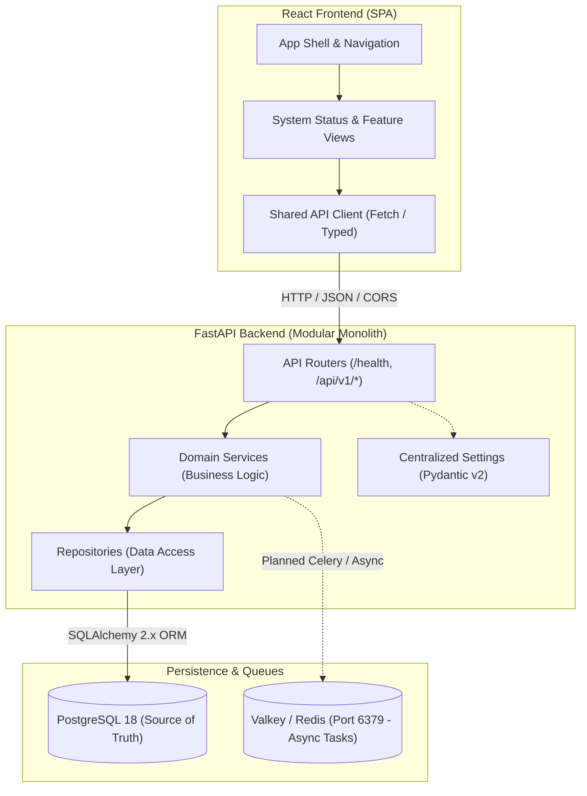
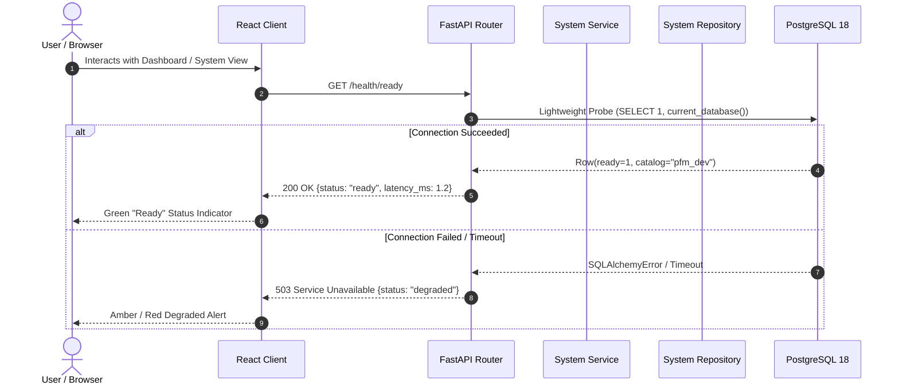

# Architecture Blueprint — AI Personal Finance Manager (India)

## 1. System Overview

The AI Personal Finance Manager is designed as a **modular monolith** optimized for single-tenant or multi-tenant India-first personal financial management. The system prioritizes exact financial arithmetic, zero fabricated data, strict user data isolation, and extensible module boundaries.



---

## 2. Layered Responsibilities

| Layer | Component | Core Responsibilities |
| :--- | :--- | :--- |
| **Presentation** | React + Vite + Tailwind | Responsive UI, state management, displaying honest system and error states, client-side routing. |
| **API Transport** | FastAPI Routes | HTTP status conventions, input validation (Pydantic v2), route serialization, OpenAPI generation. |
| **Business Logic** | Services (`app/services`) | Domain business rules, orchestration across repositories, calculations, compliance enforcement. |
| **Persistence Access** | Repositories (`app/repositories`) | Isolated SQLAlchemy queries, CRUD operations, transactions, data abstraction. |
| **Data Models** | SQLAlchemy 2.x Declarative Base | Database schema representation, table definitions, foreign keys, audit timestamps. |
| **Database** | PostgreSQL 18 | Relational source of truth, transactional DDL, ACID compliance. |
| **Migrations** | Alembic | Version-controlled, reproducible schema revisions. |
| **Background Tasks** | Celery + Valkey (Planned) | Statement parsing, document OCR, scheduled notifications, AI model inferences. |

---

## 3. Request-Response Lifecycle



---

## 4. Planned Module Boundaries

To ensure clean future implementation without architectural rewrites, domain boundaries are mapped directly to planned phases:

```text
backend/app/
├── core/                  # Global settings, security, logging, error handlers
├── db/                    # SQLAlchemy engine, session lifecycle, Alembic base
├── api/
│   ├── routes/
│   │   ├── health.py      # Liveness & readiness probes
│   │   ├── system.py      # Platform metadata (Phase 0)
│   │   ├── auth.py        # Planned: User registration, JWT, MFA (Phase 1)
│   │   ├── accounts.py    # Planned: Bank, Demat, Card accounts (Phase 2)
│   │   ├── transactions.py# Planned: Manual & parsed ledger records (Phase 2)
│   │   ├── imports.py     # Planned: Statement upload & parsing (Phase 4)
│   │   ├── budgets.py     # Planned: Budgets & savings goals (Phase 6)
│   │   ├── payments.py    # Planned: Bills & Subscriptions (Phase 7)
│   │   ├── loans.py       # Planned: Loans & EMI amortization (Phase 8)
│   │   ├── documents.py   # Planned: Receipt OCR & vault (Phase 9)
│   │   └── ai.py          # Planned: AI categorization & Assistant (Phase 10-11)
```

---

## 5. Indian Financial Specifics

The platform enforces Indian regional financial standards at the foundation layer:

1. **Currency**: Primary currency is INR (`₹`), with exact arithmetic using `Decimal` in Python and `NUMERIC(18, 4)` in PostgreSQL.
2. **Number Formatting**: Indian numbering system (Lakhs and Crores: `₹1,00,000`, `₹1,00,00,000`).
3. **Fiscal Calendar**: Financial Year starting April 1 and ending March 31.
4. **Data Residency**: Architecture prepared for local PostgreSQL storage in compliance with Indian RBI and DPDP (Digital Personal Data Protection) standards.

---

## 6. Background Worker & Asynchronous Processing Strategy

- **Stack**: Celery backed by Valkey/Redis (`127.0.0.1:6379`).
- **Use Cases**:
  - Bank statement PDF/CSV parsing pipelines.
  - OCR extraction for bills and receipts.
  - Periodic bill reminder and notification triggers.
  - Batch categorizations and spending intelligence updates.
- In Phase 0, connection parameters and dependencies are established without executing artificial background tasks.

---

## 7. Free-First AI & External Services Architecture

The project adheres to a strict free-first, privacy-first external services strategy detailed in [`docs/API_INTEGRATION_REGISTER.md`](file:///home/ckirankumar/Finance%20AI/docs/API_INTEGRATION_REGISTER.md):

1. **Deterministic Calculations First:** Financial calculations, ledger math, interest, and EMIs are executed strictly with Python `Decimal` algorithms, never delegated to an LLM.
2. **Local Open-Source OCR (Phase 7):** Local PaddleOCR extracts data from Indian bills and receipts. No paid cloud vision APIs are permitted.
3. **Groq LLM via Adapter (Phase 8 & 10):** Fast inference on open models (e.g., Llama 3) with strict data minimization and PII scrubbing before external transmission.
4. **Tavily Web Search (Phase 10):** Real-time web retrieval for current tax and market data with ground-truth citations and aggressive caching.
5. **Adapter Isolation:** All external integrations must implement domain service interfaces (`LlmServiceAdapter`, `SearchServiceAdapter`, `OcrServiceAdapter`). API keys must never be exposed to the frontend.

