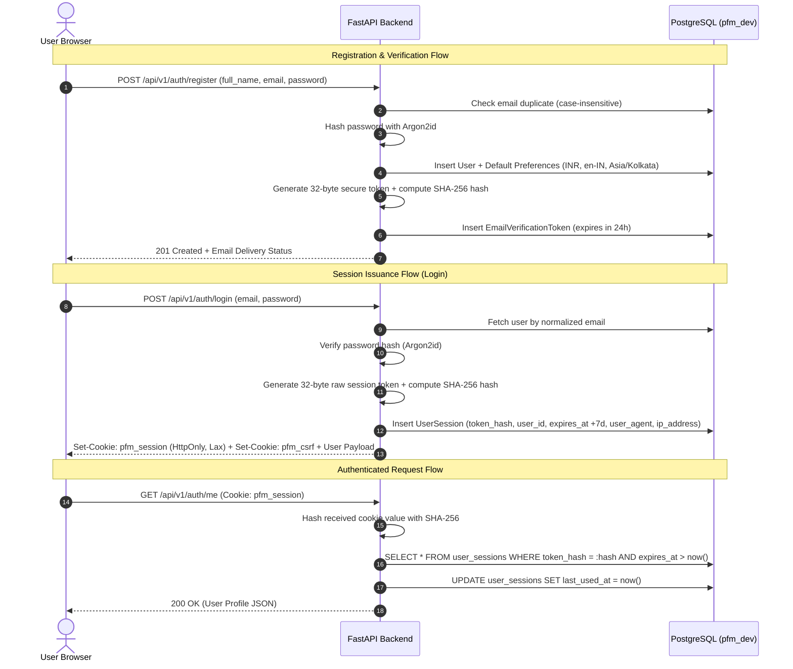

# Authentication, Session Management & Account Isolation — Architecture & Specification

## 1. Executive Summary

Phase 1 establishes the enterprise-grade identity, authentication, session management, account isolation, and onboarding infrastructure for the **AI Personal Finance Manager (India)**.

The system is architected as a **stateful, server-side session-based architecture** backed by PostgreSQL. It avoids the security pitfalls of client-side JWTs (such as irreversible token revocation, `localStorage` XSS token theft, and bloated cookie sizes) and enforces strict row-level multi-tenant isolation.

---

## 2. Security Threat Model & Defense Mechanisms

| Threat / Attack Vector | Risk | Architectural Defense Mechanism |
| :--- | :--- | :--- |
| **XSS Token Theft** | High | Session tokens are stored **exclusively** in `HttpOnly` cookies (`pfm_session`). JavaScript cannot read or extract session tokens from `document.cookie`, `localStorage`, or `sessionStorage`. |
| **CSRF (Cross-Site Request Forgery)** | Critical | Cryptographically signed double-submit CSRF pattern. Every mutating request (`POST`, `PATCH`, `DELETE`, `PUT`) requires a matching `X-CSRF-Token` HTTP header paired with the `pfm_csrf` cookie (`SameSite=Lax`). Tokens are signed using server-side HMAC-SHA256 (`<token>.<signature>`) preventing cookie injection or subdomain-based cookie tossing attacks. |
| **Credential Database Breach** | Critical | Passwords hashed using **Argon2id** (`m=65536, t=3, p=4, keylen=32`), the state-of-the-art password hashing standard resistant to GPU/ASIC brute-force attacks. |
| **Session Token Database Compromise** | Critical | **Zero raw tokens in the database**. All session tokens, email verification tokens, and password reset tokens are stored as **SHA-256 hashes**. A database leak exposes only hashed values, rendering replay impossible. |
| **Concurrent Token Consumption Race** | High | Atomic conditional updates (`UPDATE ... WHERE used_at IS NULL AND expires_at > now`) guarantee single-use consumption even under simultaneous multi-threaded race conditions. |
| **Timing Attacks on Authentication** | Medium | Constant-time password verification via `argon2-cffi`. When a non-existent email is queried, a dummy Argon2id hash is computed to equalize response times against user enumeration. |
| **Credential Stuffing / Brute Force** | High | Sliding-window in-memory rate limiter per IP and endpoint (configurable via `LOGIN_RATE_LIMIT_PER_MINUTE`, etc.). |
| **Cross-Tenant Data Tampering** | Critical | Explicit `user_id` ownership constraints enforced at the repository and service layers. User A cannot view, mutate, or delete User B's sessions or records. |

---

## 3. Session Lifecycle & Token Management

### 3.1 Token Details

1. **Session Token (`pfm_session`):**
   - Generation: `secrets.token_urlsafe(32)` (256 bits of cryptographic entropy).
   - Storage: `user_sessions.token_hash = sha256(raw_token)`.
   - Lifespan: 7 days (`604800` seconds).
   - Invalidation: Soft-invalidated by setting `revoked_at = now()` on `/logout`, all revoked on `/logout-all` or password reset.
2. **CSRF Token (`pfm_csrf`):**
   - Generation: `secrets.token_hex(32) + "." + hmac_sha256(SECRET_KEY, raw_hex)`.
   - Cookie Flags: `SameSite=Lax`, `Path=/`, not HttpOnly (so frontend can read and send in `X-CSRF-Token` header).
   - Verification: Checks both token equality and valid server-side HMAC signature.
3. **Email Verification Token:**
   - Generation: `secrets.token_urlsafe(32)`.
   - Lifespan: 24 hours. Single-use (marked with `used_at = now()` atomically; concurrent attempts rejected).
4. **Password Reset Token:**
   - Generation: `secrets.token_urlsafe(32)`.
   - Lifespan: 60 minutes. Single-use (marked with `used_at = now()` atomically, revokes all active sessions).

---

## 4. Signed Double-Submit CSRF Protection

Mutating requests (`POST`, `PATCH`, `DELETE`, `PUT`) are intercepted by the `verify_csrf` FastAPI dependency:

1. The client requests a CSRF token via `GET /api/v1/auth/csrf` (or receives one on login/register).
2. The server generates a random 32-byte hex string and appends an HMAC-SHA256 signature using `settings.SECRET_KEY`: `<raw_token>.<signature>`.
3. The server sets the cookie `pfm_csrf` containing the signed token.
4. For any state-modifying action, the client includes the token in the `X-CSRF-Token` HTTP header.
5. The backend verifies:
   - Token equality: `secrets.compare_digest(csrf_header, csrf_cookie)`
   - Cryptographic validity: `verify_csrf_token_signature(csrf_cookie)`
6. If mismatched, missing, unsigned, or forged by a malicious subdomain or attacker, the request is rejected immediately with HTTP 403 Forbidden.

---

## 5. Password Hashing Specification

- **Algorithm:** Argon2id (Type: `argon2id`, Version: 19).
- **Parameters:**
  - Memory cost: $65,536\text{ KiB}$ (64 MiB).
  - Time cost (iterations): $3$.
  - Parallelism (lanes): $4$.
  - Hash length: $32\text{ bytes}$.
  - Salt length: $16\text{ bytes}$.
- **Library:** `argon2-cffi>=23.1.0`.

---

## 6. Email Service Adapter Architecture

The application adopts a **Provider-Independent Email Service Adapter** (`app.services.email_service.EmailServiceAdapter`):

- **Development / Testing:** Captured in-memory (`InMemoryTestMailbox`), accessible via `email_service.mailbox` for automated test assertions.
- **Production (Ready):** Configurable via environment variables (`SMTP_HOST`, `SMTP_PORT`, `SMTP_USER`, `SMTP_PASSWORD`) without changing business logic or domain services.
- **Privacy Assurance:** Financial balances, statements, or PAN/Aadhaar numbers are never included in email notifications.

---

## 7. API Contract & Endpoints

| Endpoint | Method | Auth Required | CSRF Required | Description |
| :--- | :--- | :--- | :--- | :--- |
| `/api/v1/auth/csrf` | `GET` | No | No | Returns CSRF token and sets `pfm_csrf` cookie |
| `/api/v1/auth/register` | `POST` | No | Yes | Register new user, creates INR preferences, sends verification |
| `/api/v1/auth/login` | `POST` | No | Yes | Authenticates user, issues `pfm_session` and `pfm_csrf` cookies |
| `/api/v1/auth/me` | `GET` | Yes | No | Returns currently authenticated user details |
| `/api/v1/auth/logout` | `POST` | Yes | Yes | Revokes current session and clears cookies |
| `/api/v1/auth/logout-all` | `POST` | Yes | Yes | Revokes all active sessions for current user |
| `/api/v1/auth/sessions` | `GET` | Yes | No | Lists all active device sessions for current user |
| `/api/v1/auth/sessions/{id}` | `DELETE` | Yes | Yes | Revokes specific session by ID (ownership checked) |
| `/api/v1/auth/verify-email` | `POST` | No | Yes | Verifies email via single-use token |
| `/api/v1/auth/resend-verification` | `POST` | No | Yes | Resends verification token to user email |
| `/api/v1/auth/forgot-password` | `POST` | No | Yes | Issues password reset token (constant response) |
| `/api/v1/auth/reset-password` | `POST` | No | Yes | Resets password, invalidates all existing sessions |
| `/api/v1/users/me` | `GET` | Yes | No | Returns detailed user profile |
| `/api/v1/users/me` | `PATCH` | Yes | Yes | Updates user full name |
| `/api/v1/users/me/preferences` | `GET` | Yes | No | Returns regional and notification preferences |
| `/api/v1/users/me/preferences` | `PATCH` | Yes | Yes | Updates currency, locale, timezone, date format |
| `/api/v1/onboarding` | `GET` | Yes | No | Returns onboarding progress & current preferences |
| `/api/v1/onboarding` | `PATCH` | Yes | Yes | Updates onboarding profile and regional choices |
| `/api/v1/onboarding/complete` | `POST` | Yes | Yes | Finalizes onboarding wizard |
| `/api/v1/onboarding/skip` | `POST` | Yes | Yes | Skips onboarding wizard with defaults |
